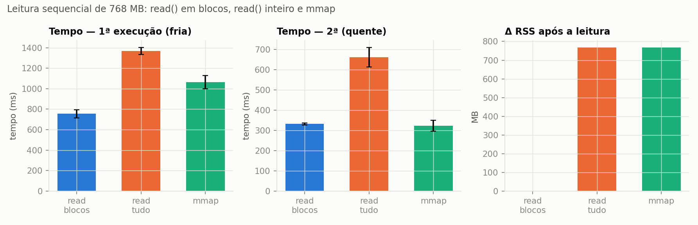
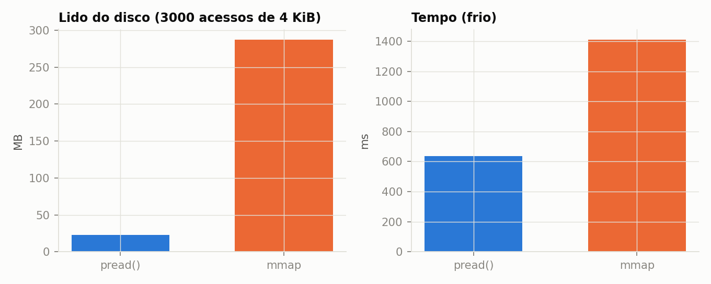
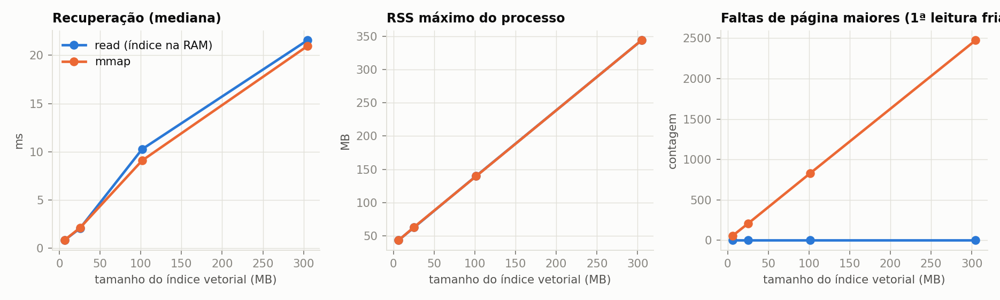
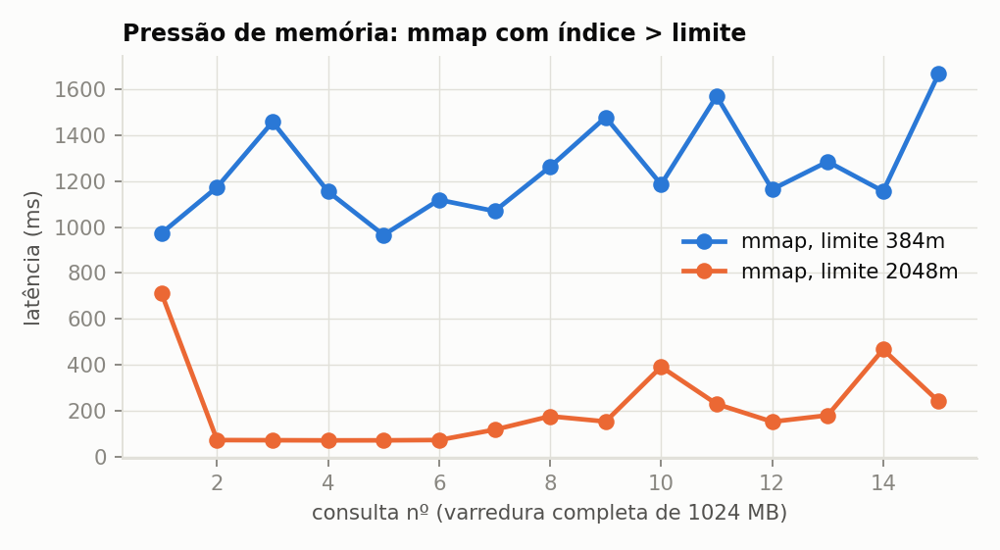
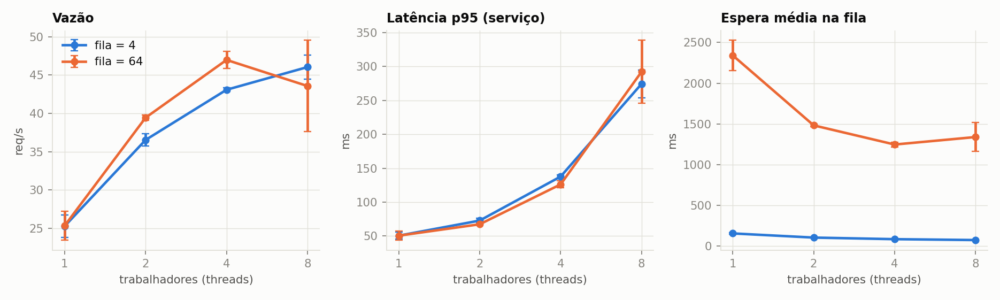
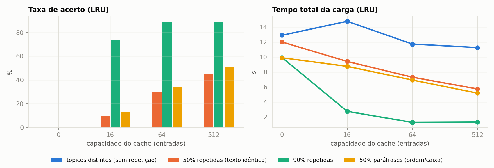
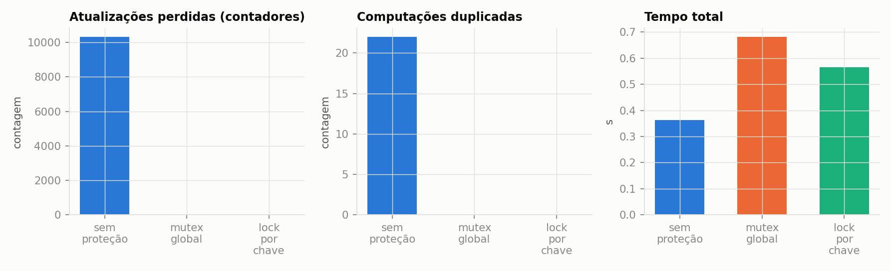

# Relatório Técnico — AV2: Memória, armazenamento, sincronização e desempenho em um serviço RAG (GenResearch-Servidor)

**Disciplina:** Sistemas Operacionais — 2026.2 | **Discente:** Leticia Cavalcanti (trabalho individual)
**Repositório:** `https://github.com/leticiacavalcaanti/SO_UFS_2026_2_AV2_Cavalcanti_Leticia` | **Commit da entrega:** `6a4bcad`
**Vídeo:** https://drive.google.com/file/d/1ZTenxEhflYIi4mIGWAJvMkZqFxuyeKsG/view?usp=sharing (ver VIDEO.md) | **Data das execuções:** 18/10/2026

## 1. Tabela de contribuição individual

| Integrante | Contribuição | Participação |
|---|---|---|
| Leticia Cavalcanti | Definição do recorte, implementação do serviço e dos experimentos, execução, análise, relatório, slides e vídeo | 100% |

O uso de IA generativa (assistente de código) na elaboração está declarado em `declaracao_uso_ia.md`.

## 2. Introdução, problema e pergunta norteadora

Aplicações de IA generativa e de RAG (*retrieval-augmented generation*) são, do ponto de vista do sistema operacional (SO), cargas que combinam: arquivos grandes lidos do armazenamento (corpus, índices, *embeddings*, *checkpoints*), memória virtual (mapeamentos, cache de páginas), filas de requisições e *caches* compartilhados por várias threads, e escrita concorrente em logs. Este trabalho implementa um serviço simplificado — o **GenResearch-Servidor** — e o usa como carga para observar como o SO administra esses recursos e que custos aparecem.

**Pergunta norteadora:** *como memória principal, memória virtual, armazenamento, caches, filas compartilhadas e mecanismos de sincronização afetam o desempenho, a estabilidade e a correção de uma aplicação de IA generativa ou de RAG?*

**Recorte experimental (e justificativa).** O foco é o SO, não a qualidade do texto. Por isso: (i) os *embeddings* são **simulados** (hashing, determinísticos) e a **geração é simulada** (latência configurável + CPU proporcional ao contexto) — isso elimina a dependência de chave de API, de pesos de modelo e de GPU, e torna tudo reprodutível; (ii) o corpus é **sintético**; (iii) o recorte cobre as configurações C1–C6 e a Parte D com as opções 1 (produtor/consumidor) e 2 (cache compartilhado), além de log concorrente e deadlock isolado. A ideia de *chunking* por palavras com sobreposição e de similaridade de cosseno sobre vetores normalizados vem de um serviço RAG anterior da autora (projeto glpimentor), reescrito aqui sem nenhuma dependência dele.

## 3. Ambiente (Parte A)

| Item | Valor |
|---|---|
| Hospedeiro | Windows 11 Home, Docker Desktop 28.3.2 (backend WSL2) |
| Ambiente Linux | **Contêiner** `python:3.12-slim` (Debian GNU/Linux 13 "trixie") sobre a VM Linux do Docker Desktop |
| Kernel | 6.6.87.2-microsoft-standard-WSL2 (x86_64) |
| CPU | Intel Core i5-10210U, 4 CPUs lógicas (2 núcleos × 2 threads), 1,6 GHz base |
| RAM / swap | 5,8 GiB / 1,0 GiB (VM); página de 4 KiB |
| Armazenamento | disco virtual da VM (ext4); corpus e índices em volume Docker |
| GPU | nenhuma (somente CPU) |
| Linguagem/bibliotecas | Python 3.12, numpy 2.1.3, matplotlib 3.9.2, SQLite (stdlib) |
| Modelo/ferramenta | nenhum modelo real: vetores e geração simulados (ver §2) |

Comandos executados e saídas completas: `results/env/ambiente_container.txt` (`uname -a`, `os-release`, `lscpu`, `free -h`, `/proc/meminfo`, `lsblk`, `df -h`, `swapon --show`, `vmstat`, `iostat -xz`) e `results/env/ambiente_host_docker.txt`.

**MemFree, MemAvailable, cache e swap.** `MemFree` é a RAM totalmente ociosa; `MemAvailable` é a estimativa do kernel de quanto pode ser dado a novos processos sem *swap*, **incluindo** o cache de páginas e *slabs* reclamáveis; "cache" (`Cached`) é a memória usada pelo **cache de páginas**, que guarda conteúdo de arquivos já lidos; *swap* é o espaço em disco para páginas anônimas expulsas da RAM. O cache de páginas não é memória desperdiçada: é reutilizável (a 2ª leitura de um arquivo evita o disco, como medido em §8) e é devolvido sob pressão — por isso olhar só `MemFree` leva a conclusões erradas. Para datasets, índices, *embeddings* e *checkpoints*, isso significa que ler um arquivo grande uma vez "enche" o cache, que a primeira leitura paga E/S e as seguintes não, e que um arquivo maior que a memória disponível não tem como ficar todo em cache (§8.2).

## 4. Arquitetura

```
2 produtores ─put→ BoundedBuffer (semáforos empty/full + mutex) ─get→ N trabalhadores (threads)
trabalhador: cache compartilhado ──miss→ embedding da consulta → varredura do índice (.npy: read ou mmap)
             → textos dos trechos no SQLite → contexto limitado → geração (simulada) → grava no cache
logs de eventos (mutex) · métricas via /proc, getrusage e cgroup v2
```

- **Ingestão** (`genresearch/store.py`): lê `.txt`, fragmenta em trechos de 100 palavras com 20 de sobreposição, gera um vetor float32 de 256 dimensões por trecho e grava `vectors.npy` (N×256) + `meta.sqlite` (documento, ordem, texto).
- **Recuperação:** top-k (k=5) por produto escalar, varrendo o índice em blocos de 32.768 linhas — idêntico para índice carregado na RAM (`np.load`) ou mapeado (`np.load(mmap_mode="r")`, que usa `mmap`).
- **Contexto:** concatena os trechos até um limite de bytes (≈ tokens × 4), registrando trechos, bytes e tokens aproximados.
- **Geração simulada:** `sleep` (latência de um serviço externo, 20 ms) + SHA-256 repetido sobre o contexto (CPU proporcional ao contexto).
- **Trabalhadores = threads.** A carga é mista: a espera da geração (`sleep`), o `matmul` do numpy e o `hashlib` com buffers grandes liberam o GIL; processos custariam cópia/compartilhamento do índice e IPC para ganho pequeno neste recorte. (A escolha foi testada empiricamente em §9.1, onde se vê o limite do GIL/CPU.)

## 5. Dados, corpus, *embeddings*, índice e cache

O corpus é gerado por `genresearch/corpus.py` com semente fixa: 12 tópicos, cada um com vocabulário próprio (70% das palavras de um documento vêm do tópico, 30% do vocabulário global), de modo que consultas de um tópico realmente recuperam trechos dele. Nada é real nem pessoal. Tamanhos usados:

| Documentos | Trechos | Corpus (texto) | `vectors.npy` | SQLite |
|---|---|---|---|---|
| 200 (smoke) | 2.600 | 1,6 MB | 2,5 MB | 2,4 MB |
| 500 | 6.500 | ≈ 4 MB | 6,4 MB | — |
| 2.000 (C3, C4, C6) | 26.000 | ≈ 17 MB | 25 MB | — |
| 8.000 | 104.000 | ≈ 68 MB | 102 MB | — |
| 24.000 | 312.000 | ≈ 200 MB | 305 MB | — |

(valores completos em `…/stats.json`, reproduzidos pelos scripts). **Cache compartilhado:** LRU ou FIFO, com capacidade configurável, chave canônica da consulta (palavras únicas ordenadas, sem *stopwords* — paráfrases por reordenação colidem), protegido por mutex; registra acertos, erros, substituições e o tempo economizado (custo de recuperação+geração de cada resposta, somado a cada acerto).

## 6. Processos, threads, filas e recursos compartilhados

Há um processo Python e, nele: 2 threads produtoras, N trabalhadoras e a *thread* principal; o numpy cria ainda um *pool* de threads do OpenBLAS (visto em §10). Recursos compartilhados e seu controle:

| Recurso | Risco sem proteção | Proteção |
|---|---|---|
| Fila de requisições | perda/duplicação, estouro | `BoundedBuffer`: semáforos `empty`/`full` + mutex; número de sequência sob o mutex para verificar FIFO |
| Cache de respostas | atualização perdida, computação duplicada | `Lock` na estrutura e nos contadores |
| Arquivo de log | linhas intercaladas | `Lock` em `SafeLogger` |
| Conexão SQLite | uso de uma conexão por várias threads | uma conexão somente-leitura por thread (`threading.local`) |
| Índice vetorial | — | somente leitura após a ingestão (sem escrita concorrente) |

## 7. Estratégia de sincronização e metodologia

**Mecanismos adotados:** semáforos contadores (`empty`, `full`) + mutex para o buffer limitado (Opção 1); mutex global e lock **por chave** (*single-flight*) para o cache (Opção 2); mutex no log; ordenação global de locks e `acquire` com *timeout* + recuo para o deadlock.

**Metodologia.** Cada configuração foi repetida **3 vezes**; as tabelas trazem média (± desvio-padrão quando relevante). Mesma aplicação e mesmo corpus em cada comparação, salvo a variável explicitamente alterada. Fatores variados: nº de trabalhadores (1, 2, 4, 8), capacidade da fila (4, 64), tamanho do corpus (6 a 305 MB de índice), contexto (500, 2.000, 8.000 B), capacidade (0, 16, 64, 512) e política (LRU/FIFO) do cache, uso de `mmap`, padrão de leitura (sequencial/aleatório), estado do cache de páginas (frio/quente) e limite de memória (cgroup). Métricas: latência (média, mediana, p95), vazão, RSS/VSZ (`/proc/self/status`), `MemAvailable`, faltas de página e bytes lidos do disco (`getrusage`, `/proc/self/io`, cgroup), fila (média/máxima/espera), utilização, acertos/erros/substituições, perdas/duplicações. Comandos exatos: README (`python scripts/run_all.py`). Resultados brutos: `results/*.csv`; logs: `results/logs/`; tabelas: `results/tabelas_resumo.md`.

**Estado "frio".** Antes de cada execução fria, as páginas do arquivo são despejadas com `posix_fadvise(POSIX_FADV_DONTNEED)` (não exige privilégio). Vale para o cache de páginas da VM Linux; o disco virtual ainda pode ser cacheado pelo Windows (ver §13).

## 8. Resultados: memória, armazenamento, paginação e E/S

### 8.1 C1 × C2 — `read()` convencional × `mmap` (Parte E)

Arquivo aleatório de 16, 128 e 768 MB; leitura sequencial em blocos de 1 MiB (`read` em blocos, `read` do arquivo inteiro para a RAM, `mmap`) e 3.000 acessos aleatórios de 4 KiB (`pread` × `mmap`); 1ª execução (fria) e 2ª (quente). Médias de 3 repetições, arquivo de 768 MB:

| Método / padrão | Cache | Abertura (ms) | Leitura (ms) | ΔRSS (MB) | ΔVSZ (MB) | Faltas maiores | Lido do disco (MB) |
|---|---|---|---|---|---|---|---|
| `read` em blocos, seq. | fria | 0,005 | 755 | 0 | 0 | 0 | 768 |
| `read` em blocos, seq. | quente | 0,005 | 331 | 0 | 0 | 0 | 0 |
| `read` tudo, seq. | fria | 0,005 | 1.369 | 768 | 768 | 0 | 768 |
| `read` tudo, seq. | quente | 0,012 | 661 | 768 | 768 | 0 | 0 |
| `mmap`, seq. | fria | 0,021 | 1.064 | 768 | 768 | 6.146 | 768 |
| `mmap`, seq. | quente | 0,024 | 322 | 768 | 768 | 0 | 0 |
| `pread` 4 KiB, aleatório | fria | 0,005 | 637 | 0 | 0 | 0 | **23** |
| `mmap`, aleatório | fria | 0,036 | 1.410 | 165 | 768 | 2.441 | **287** |
| `pread` 4 KiB, aleatório | quente | 0,007 | 12,8 | 0 | 0 | 0 | 0 |
| `mmap`, aleatório | quente | 0,029 | 17,6 | 165 | 768 | 0 | 0 |


<p class="fig">Figura 1 — Leitura sequencial de 768 MB (média ± desvio-padrão, 3 repetições): tempo frio, tempo quente e ΔRSS.</p>

Observações (todas medidas; as explicações causais são interpretações):

1. **Abertura:** `mmap` custa ~20–40 µs (mapeia, não lê) contra ~5 µs do `open`; o VSZ já sobe 768 MB na abertura (espaço de endereços reservado), mas o RSS só cresce quando as páginas são tocadas — **VSZ ≠ memória física**.
2. **Primeira × segunda execução:** a 2ª execução é 2,3× (`read` em blocos), 2,1× (`read` tudo) e 3,3× (`mmap`) mais rápida e **não lê nada do disco** (0 MB): é o cache de páginas.
3. **Faltas de página:** `read()` não gera falta maior (os dados são copiados pelo kernel na chamada de sistema), enquanto o `mmap` gerou 6.146 faltas maiores na leitura fria sequencial — 768 MB / 6.146 ≈ 125 KiB por falta, compatível com leitura antecipada (*readahead*) em janelas de ~128 KiB. Na 2ª execução, 0 faltas maiores, mas ~12.288 faltas menores (a tabela de páginas do processo é preenchida a partir do cache).
4. **`read` do arquivo inteiro é o pior caso** (2× mais lento que ler em blocos): além da cópia, precisa de 768 MB de memória anônima e ~196.600 faltas menores de primeiro acesso; o RSS fica em 768 MB. Ler em blocos mantém o RSS estável. Isso é o que acontece ao carregar um *checkpoint* inteiro com `read()`.
5. **Acesso aleatório frio:** o `mmap` leu **287 MB** do disco para atender 3.000 acessos que somam ~12 MB úteis (12× de amplificação, ~117 KiB por falta), contra 23 MB do `pread` (2× de amplificação), e foi 2,2× mais lento. Com acesso esparso e frio, `mmap` não é vantajoso; quente, a diferença cai (17,6 × 12,8 ms).
6. **Tamanhos pequenos (16 MB):** as diferenças absolutas são pequenas (21–30 ms na leitura fria) — o custo relevante só aparece com arquivos grandes.


<p class="fig">Figura 2 — Acesso aleatório frio (768 MB): bytes lidos do disco e tempo, `pread` × `mmap`.</p>

### 8.2 C5 — pressão de memória

**(a) Crescimento do corpus e do contexto (1 trabalhador, 150 consultas; cada configuração em processo novo, 1ª leitura fria).**

| Docs | Índice (MB) | Recuperação mediana (ms) | RSS máx (MB) | VSZ máx (MB) | Faltas maiores `read` / `mmap` | Lido do disco (MB) |
|---|---|---|---|---|---|---|
| 500 | 6 | 0,8 | 44 | 448 | 0 / 56 | 6 |
| 2.000 | 25 | 2,0 | 63 | 467 | 0 / 209 | 25 |
| 8.000 | 102 | ≈ 9–10 | 140 | 545 | 0 / 830 | 102 |
| 24.000 | 305 | ≈ 21 | 344 | 748 | 0 / 2.474 | 305 |


<p class="fig">Figura 3 — Efeito do tamanho do índice (contexto de 2.000 B): recuperação, RSS máximo e faltas maiores.</p>

- A recuperação cresce **linearmente** com o índice (≈ 70 µs/MB): a varredura é O(N). O RSS acompanha o tamanho do índice (≈ índice + ~40 MB-base): a 305 MB o processo tem 344 MB.
- **`read` e `mmap` têm RSS e latência de recuperação praticamente iguais em regime estacionário**, porque a varredura toca todo o índice e, depois da 1ª consulta, tudo está no cache de páginas. A diferença está **no momento do custo**: `read` paga tudo na abertura (e exige RAM anônima do tamanho do índice), `mmap` paga nas faltas de página durante a 1ª consulta (2.474 faltas maiores ≈ 126 KiB cada).
- **Contexto:** o tempo de geração cresce com o contexto (≈ 20 ms com 500 B, 34–44 ms com 2.000 B, ≈ 100–120 ms com 8.000 B) porque a CPU do SHA-256 é proporcional ao contexto; o RSS quase não muda. Com limite de 500 B nenhum trecho (~700 B) cabe quase sempre (contexto médio de 22–53 B): na prática o limite de contexto trunca/descarta informação — numa aplicação real, isso degradaria a qualidade da resposta.
- As faltas **menores** não são comparáveis entre tamanhos neste experimento (dependem do alocador e de *buffers* temporários do numpy; observamos um pico não monotônico em 102 MB que **não** investigamos), por isso não as interpretamos.

**(b) Índice maior que o limite de memória (cgroup, swap do contêiner desligado).** Índice sintético de 1.024 MB; 15 consultas, cada uma varrendo todo o índice; `docker run --memory=<limite> --memory-swap=<limite>`. O cache de páginas do arquivo é despejado antes de cada execução, para que as páginas sejam carregadas — e cobradas — *dentro* do cgroup do teste.

| Limite | Modo | Resultado (3 de 3 repetições) | Mediana/consulta (ms) | Faltas maiores | Lido do disco |
|---|---|---|---|---|---|
| 2.048 MB | `read` | conclui 15/15 | 70–103 | 0 | 1,0 GB |
| 2.048 MB | `mmap` | conclui 15/15 | 89–153 | ≈ 8.300 | 1,0 GB |
| **384 MB** | **`read`** | **morto pelo OOM killer (exit 137)** | — | — | — |
| **384 MB** | **`mmap`** | **conclui 15/15, RSS limitado a ≈ 399 MB** | **1.174–1.589** | **≈ 125.000** | **≈ 15,3 GB** |


<p class="fig">Figura 4 — Latência por consulta com `mmap` e índice de 1 GB: limite de 2 GB (cabe) × 384 MB (não cabe).</p>

- Com 384 MB, `read` precisa de ~1 GB de memória **anônima** (não reclamável sem swap) e o kernel mata o processo (C6, "limite de memória"). O `mmap` mapeia páginas **de arquivo** (limpas, reclamáveis): o kernel as descarta e relê quando necessário, então o processo **sobrevive**, mas com **thrashing**: cada consulta varre 1 GB sequencialmente, o cache (≈ 384 MB) nunca retém o que a próxima varredura precisa (o acesso sequencial cíclico a um conjunto maior que o cache faz a política de substituição falhar quase sempre), e **todas as 15 varreduras relêem do disco** (15,3 GB ≈ 15 × 1.024 MB). O resultado é ~13–17× mais lento que com 2 GB.
- **Swap não foi exercitado**: o contêiner foi executado sem swap (`--memory-swap` igual a `--memory`) para não pressionar a VM/hospedeiro; a VM tinha ~1 MB de swap em uso em todos os casos. A paginação observada é de **arquivo** (faltas maiores), não de swap de páginas anônimas. Não foi feita uma execução com swap habilitado.

## 9. Resultados: concorrência, cache e correção

### 9.1 C3 — concorrência e fila

400 consultas distintas (cache desligado), 2 produtores, 2.000 documentos, geração com `sleep` de 20 ms + CPU (3.000 passes de SHA-256). Média ± desvio-padrão de 3 repetições:

| Fila | Workers | Vazão (req/s) | p95 do serviço (ms) | Espera média na fila (ms) | Fila média / máx |
|---|---|---|---|---|---|
| 4 | 1 | 25,3 ± 1,5 | 51 | 157 | 3,5 / 4 |
| 4 | 2 | 36,5 ± 0,8 | 73 | 106 | 3,3 / 4 |
| 4 | 4 | 43,1 ± 0,2 | 138 | 87 | 3,2 / 4 |
| 4 | 8 | 46,0 ± 1,5 | 274 | 76 | 3,0 / 4 |
| 64 | 1 | 25,4 ± 1,9 | 51 | 2.341 | 58,5 / 64 |
| 64 | 2 | 39,4 ± 0,3 | 67 | 1.483 | 58,3 / 64 |
| 64 | 4 | 47,0 ± 1,1 | 126 | 1.248 | 58,2 / 64 |
| 64 | 8 | 43,6 ± 6,0 | 292 | 1.340 | 58,0 / 64 |


<p class="fig">Figura 5 — Vazão, latência p95 do serviço e espera na fila × número de trabalhadores, para filas de 4 e de 64.</p>

- **A concorrência aumentou a vazão, mas com retorno decrescente:** 2 workers = 1,44–1,55× a de 1; 4 workers = 1,7–1,85×; 8 workers = sem ganho (fila 64: 47,0 → 43,6 req/s, com desvio-padrão de 6) e **p95 do serviço 5× maior** que com 1 trabalhador (51 → 292 ms). Com 4 CPUs lógicas (2 núcleos físicos) e parte do trabalho segurando o GIL, mais threads só adicionam disputa e trocas de contexto: contenção e degradação, sem ganho de vazão.
- **Fila maior não aumenta a vazão; aumenta a latência.** A fila ficou sempre praticamente cheia (média 58 de 64) porque os produtores são mais rápidos que os consumidores; com fila 64, a espera média foi de 1,2–2,3 s contra 0,08–0,16 s com fila 4 (efeito de lei de Little / *bufferbloat*). O limite da fila é o que dá *backpressure*: o produtor bloqueia (semáforo `empty`) em vez de acumular memória sem limite (RSS 114–388 MB).
- **Correção:** em todas as execuções, 0 requisições perdidas, 0 duplicadas e 0 violações de FIFO.
- **Utilização dos trabalhadores:** ≈ 0,99–1,0 (carga saturante).
- **Teste de hipótese (OpenBLAS).** Em `ps -L` (§10) viram-se 3 threads com ~82% de CPU e quase nenhuma troca voluntária — compatível com o *pool* do OpenBLAS (numpy) em espera ativa. Repetindo C3 (fila 64) com `OPENBLAS_NUM_THREADS=1`: 29,4 ± 0,5 (1 worker), 43,8 ± 1,4 (2), 41,9 ± 6,3 (4) e 45,9 ± 16,0 (8) req/s (`results/c3_openblas1.csv`). Ou seja, ≈ +10–15% com 1–2 workers, mas **a saturação acima de 2 workers persiste**; logo o OpenBLAS explica só uma parte e não identificamos a causa total (GIL, núcleos físicos, ruído do hospedeiro). A variância alta com 4–8 workers indica ruído do ambiente.

### 9.2 C4 — cache compartilhado

400 requisições, 2 workers, mesma carga de CPU. Cenários: consultas todas distintas (tópicos/palavras diferentes), 50% e 90% de repetições de texto idêntico, e 50% de paráfrases (mesma consulta com ordem/caixa alteradas — a chave canônica trata como igual).

| Cenário | Cache (LRU) | Acerto | Erros (miss) | Substituições | Tempo economizado | Tempo total |
|---|---|---|---|---|---|---|
| distintas | 512 | 0% | 400 | 0 | 0 s | 11,3 ± 1,0 s |
| repetidas 50% | 0 | 0% | 400 | 0 | 0 s | 12,0 ± 0,8 s |
| repetidas 50% | 512 | 44,7% | 221 | 0 | 9,3 s | 5,7 ± 0,05 s |
| repetidas 90% | 0 | 0% | 400 | 0 | 0 s | 9,9 ± 0,2 s |
| repetidas 90% | 16 | 74,0% | 104 | 70 | 16,2 s | 2,7 s |
| repetidas 90% | 64 | 89,2% | 43 | 0 | 19,2 s | 1,25 ± 0,14 s |
| paráfrase 50% | 512 | 50,9% | 196 | 0 | 10,9 s | 5,2 ± 0,2 s |


<p class="fig">Figura 6 — Taxa de acerto e tempo total × capacidade do cache, por cenário (LRU).</p>

- **O cache reduziu tempo e operações de recuperação** quando há repetição: com 90% de repetição, 89,2% de acerto evitou 357 das 400 recuperações+gerações e reduziu o tempo total de 9,9 s para 1,25 s (≈ 8×; vazão 40 → ≈ 320 req/s). Com consultas semanticamente distintas, a taxa de acerto é **0%** e o cache só adiciona custo (inserções e, com capacidade pequena, 384 substituições).
- A capacidade importa até cobrir o conjunto de consultas repetidas: com 90% de repetição, 16 entradas → 74%, 64 → 89,2%, 512 → 89,2% (o teto é o limite imposto pelas primeiras ocorrências).
- **LRU × FIFO** (capacidade 16): 74,0% × 73,7% (90%) e 9,9% × 10,2% (50%) — sem diferença apreciável, porque as repetições foram sorteadas uniformemente (sem localidade temporal forte); com carga enviesada, LRU deveria ganhar (não testado).
- **Ruído:** com cache desligado, a mesma quantidade de trabalho levou de 9,9 s a 12,9 s (± 2,7 s) entre cenários; diferenças de tempo menores que ~25% neste ambiente **não são significativas**. Os ganhos acima (≥ 2×) estão bem fora desse ruído.

### 9.3 C6 — falhas controladas

| Cenário | Resultado (média de 3) |
|---|---|
| Arquivo/índice ausente | 40 requisições → 40 erros controlados, 80 retentativas (2 por requisição), processo não caiu, 0,6 s |
| Índice indisponível por 0,6 s e depois restaurado | 120/120 concluídas com sucesso após retentativas com recuo; 2,2 s |
| Fila saturada, produtor com *timeout* (rejeita) | 8 concluídas, **112 rejeitadas** (93%) e registradas; 0 perdas silenciosas |
| Fila saturada, produtor bloqueia (sem *timeout*) | 120/120 concluídas, 4,0 s (*backpressure*) |
| Serviço externo falhando em 30%, sem retentativa | 79 ok, **41 erros (34%)** |
| Idem, com até 3 retentativas | 119 ok, **1 erro**, 55 retentativas; 1,8 s (≈ +88% de tempo) |
| Limite de memória | §8.2(b): `read` morto por OOM (exit 137, 3/3); `mmap` sobrevive com *thrashing* |

Trade-off: rejeitar protege a latência e a memória, mas perde trabalho (exige que o cliente trate o erro); bloquear não perde nada, mas empurra a espera para o produtor. Retentativas convertem falhas transitórias em sucesso ao custo de tempo extra; falhas permanentes (arquivo ausente) apenas multiplicam o custo se o limite de tentativas for alto.

## 10. Parte D — sincronização: falhas demonstradas e correções

As janelas de corrida foram ampliadas **de propósito** (`time.sleep(0)` entre leitura e escrita e `sys.setswitchinterval(1e-6)`): é injeção de falha controlada; em condições normais a corrida existiria, mas seria bem mais rara.

**D1 — cache compartilhado (8 threads × 1.500 operações, 40 chaves).**

| Modo | Atualizações perdidas | Computações (ideal = 40) | Duplicadas | Tempo (s) |
|---|---|---|---|---|
| Sem proteção | **10.334 de 12.000 (86%)** | 62 | **22** | 0,36 |
| Mutex global | 0 | 40 | 0 | 0,68 |
| Lock por chave (*single-flight*) | 0 | 40 | 0 | 0,56 |


<p class="fig">Figura 7 — Cache sem proteção × mutex global × lock por chave.</p>

Sem proteção, o contador `hits += 1` (ler–somar–escrever) perde atualizações e duas threads calculam a mesma chave (*cache stampede*). O mutex global corrige, mas serializa também a computação cara (0,68 s); o lock por chave mantém a correção e reduz o tempo em ~18% porque chaves diferentes computam em paralelo — ao custo de mais código e de um mapa de locks. A versão sem proteção é "mais rápida" só porque está errada.

**D2 — log concorrente.** `UnsafeLogger` (linha escrita em três partes, sem lock): em 2.400 eventos, **1.817 linhas (76%) corrompidas** (mistura de partes de eventos diferentes); `SafeLogger` (mutex): **0**. O mutex custa a serialização da escrita (aceitável aqui, pois o log é pequeno e em *buffer*).

**D3 — produtor/consumidor com buffer limitado.** 3 produtores × 500 itens, 2 consumidores, capacidades 1, 4 e 64: **0 perdidos, 0 duplicados, 0 violações de FIFO** em todas as 18 execuções. Com consumidor lento, o produtor ficou bloqueado ≈ 1,2 s no total e a ocupação máxima igualou a capacidade (*backpressure*); com produtor lento, os consumidores esperaram ≈ 1,0 s (semáforo `full`) e a ocupação máxima ficou em ≤ 3. A capacidade só altera **onde** a espera acontece, não a correção.

**D4 — deadlock (espera circular) em processo isolado.** Duas threads pegam dois locks em ordem oposta (A→B, B→A). Em 3/3 repetições o subprocesso **não terminou**; após 3 s o processo pai o classificou como *deadlock*, registrou o estado das threads e o **encerrou (`kill`)**. Em `/proc/<pid>/task/*/wchan`, as threads estavam em `S (sleeping)` aguardando `futex_wait_queue` (esperando um lock que nunca será liberado). Correções testadas: **ordenação global de locks** (ambas as threads pegam A antes de B → 0,30 s, sem deadlock) e **`acquire` com *timeout* + recuo assimétrico** (desiste, libera o primeiro lock e tenta de novo → 0,60 s). Trade-off: a ordenação exige disciplina em todo o código; o *timeout* adiciona latência e a necessidade de recuo para evitar *livelock*. Não demonstramos *starvation*.

**Evidências de SO** (`results/evidence/`): `ps -L`, `/proc/<pid>/status`, trocas de contexto por thread, `pidstat -t`, `vmstat`, `iostat`, `smaps_rollup`, `strace -c -f`. Com 4 trabalhadores + 2 produtores: 11 threads no processo; 3 threads em estado `Rl` com ≈ 82% de CPU e quase nenhuma troca voluntária (compatível com espera ativa do OpenBLAS — hipótese testada parcialmente em §9.1); as demais em `futex_wait_queue`. No `strace -c -f` do pipeline, **`futex` respondeu por 70% do tempo em chamadas de sistema** (3.919 chamadas) — o custo de sincronização entre threads —, seguido de `clock_nanosleep` (16%, a geração simulada). O `strace` de `read` × `mmap` mostra, para o mesmo arquivo de 16 MB, uma sequência de `read(3, …, 1048576)` no primeiro caso e **um único `mmap(NULL, 16777216, PROT_READ, MAP_SHARED, 3, 0)`** no segundo — a leitura passa a ocorrer por faltas de página, invisíveis ao `strace`.

## 11. Relação com Sistemas Operacionais e IA generativa

- **Memória virtual e cache de páginas:** carregar embeddings/índices/checkpoints com `read()` exige memória anônima do tamanho do arquivo (e OOM se não couber); `mmap` evita essa cópia e a reserva, funciona acima da RAM, mas vira *thrashing* se o conjunto de trabalho não cabe no cache — como numa varredura completa de índice vetorial a cada consulta. A segunda leitura é rápida pelo cache de páginas; por isso o primeiro *token* (carga fria) é bem mais lento que os seguintes.
- **RAG:** a recuperação por força bruta é O(N) em tempo e em bytes lidos; índices aproximados (HNSW, IVF) existem para cortar esse custo e a pressão de memória. O limite de contexto é simultaneamente limite de custo (CPU/memória) e de qualidade.
- **Filas e *backpressure*:** em serviços de inferência, fila ilimitada vira latência e memória; limite + rejeição/bloqueio é uma decisão de projeto.
- **Caches de resposta:** só pagam quando há repetição; consultas semanticamente distintas dão 0% de acerto (um cache semântico baseado em similaridade de embeddings aceitaria paráfrases não triviais — não implementado).
- **Concorrência:** o ganho de vazão satura por GIL/CPU; em inferência real a contenção seria por GPU/memória de dispositivo.

## 12. Respostas às questões de análise (síntese)

1. *Corpus/índice/contexto × RAM, paginação e latência:* índice 6→305 MB: recuperação 0,8→21 ms (linear), RSS 44→344 MB; contexto 500→8.000 B: geração 20→~110 ms (§8.2a).
2. *`read` × `mmap`:* §8.1 — `mmap` abre mais rápido? não (20–40 µs × 5 µs) mas não lê; é melhor que `read` do arquivo inteiro, pior que `read` em blocos na leitura fria sequencial e pior em acesso aleatório frio (287 × 23 MB lidos).
3. *Cache:* sim, até 8× menos tempo e 89% de acerto com 90% de repetição; 0% sem repetição (§9.2).
4. *Concorrência:* +70–85% de vazão com 4 workers; sem ganho e p95 5× pior com 8 (§9.1).
5. *Exclusão mútua / eventos:* cache, log e estruturas da fila (mutex); `empty`/`full` para sincronização de eventos da fila (§6).
6. *Corrida/deadlock demonstrados:* atualização perdida (86%), duplicação de computação (22), log intercalado (76%) e deadlock isolado com recuperação (§10).
7. *Mecanismos e trade-offs:* mutex global × por chave, ordenação × *timeout* (§10).
8. *Paginação intensa, swap:* paginação de **arquivo** intensa no limite de 384 MB (≈ 125 mil faltas maiores, 15,3 GB lidos); **swap não exercitado** (§8.2b).
9. *Relação com RAG/checkpoints/caches:* §11.
10. *Limitações:* §13.

## 13. Limitações

- **Ambiente virtualizado:** contêiner sobre WSL2 sobre Windows; o "disco" é virtual e pode ser cacheado pelo hospedeiro, então "frio" significa *frio no cache de páginas da VM*, não necessariamente no disco físico. Máquina de 2 núcleos físicos, compartilhada com o Windows: há ruído (ex.: 9,9–12,9 s para trabalho equivalente no C4; desvio-padrão alto com 8 workers).
- **Geração e embeddings simulados:** não há GPU, VRAM, KV-cache nem pesos; a "geração" é `sleep` + hash. Resultados sobre CPU/GIL **não** se transferem a modelos grandes, múltiplas GPUs ou ambientes distribuídos, onde dominam transferência host↔dispositivo, memória da GPU, comunicação entre nós e *checkpoints* de dezenas de GB.
- **Corpus pequeno** (≤ 305 MB de índice) e sintético; índice de força bruta (sem HNSW/IVF); consultas com distribuição uniforme.
- **Corrida com injeção de falha:** as taxas de perda (86%, 76%) valem para janelas ampliadas artificialmente, não para o código "natural".
- **Swap** e **starvation** não foram exercitados; faltas menores no C5a não foram interpretadas; a causa total da saturação com > 2 workers não foi isolada (apenas parte atribuída ao OpenBLAS).
- Três repetições dão desvio-padrão pouco robusto; diferenças pequenas (< 25% em tempo) devem ser lidas com cautela.

## 14. Conclusão

O serviço implementado e medido mostrou, com evidências reprodutíveis, que: (i) o cache de páginas explica a diferença entre 1ª e 2ª leitura e que carregar tudo com `read()` é o caminho mais caro em memória; (ii) `mmap` troca RAM anônima por paginação sob demanda — permite operar um índice (1 GB) maior que o limite de memória (384 MB) onde `read` é morto pelo OOM, ao custo de *thrashing* (~15× mais lento, 15 GB lidos); (iii) mais threads não significam mais vazão — há saturação em 2–4 workers e piora do p95 com 8 —, e filas grandes viram latência, não vazão; (iv) um cache compartilhado só compensa com repetição, mas então reduz o tempo em até ~8×; e (v) sem exclusão mútua o cache e o log ficam incorretos (86% de atualizações perdidas, 76% de linhas corrompidas) e a ordem de aquisição de locks pode produzir deadlock, evitável por ordenação global ou *timeouts*, cada um com seu custo. Tudo isso é fruto de decisões do sistema operacional — memória virtual, cache de páginas, escalonamento e primitivas de sincronização — que uma aplicação de IA generativa herda.

## 15. Referências

- Silberschatz, Galvin, Gagne. *Fundamentos de Sistemas Operacionais* (capítulos de memória virtual, sincronização e deadlock).
- Tanenbaum, Bos. *Sistemas Operacionais Modernos*.
- `man 2 mmap`, `man 2 posix_fadvise`, `man 5 proc` (`/proc/meminfo`, `/proc/<pid>/io`, `/proc/<pid>/status`), `man 2 getrusage`, `man 7 cgroups` e documentação do cgroup v2 (`memory.max`, `memory.events`, `memory.stat`).
- Documentação do Python (`threading`, `mmap`, `sqlite3`) e do numpy (`numpy.load` com `mmap_mode`).
- Lewis et al. *Retrieval-Augmented Generation for Knowledge-Intensive NLP Tasks* (NeurIPS 2020).
- Código autoral deste repositório; *chunking* e similaridade de cosseno inspirados no projeto glpimentor_servicoia (mesma autora).
